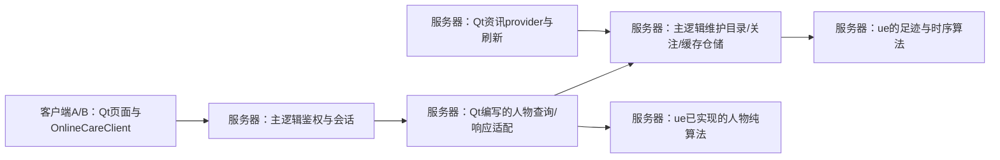

# 项目交接与分工：按 GitHub 最新 main 核验

核验日期：2026-11-16（北京时间）  
基线：`main = df37c0d795bc1b2bd95a080a6bbf0a7f24f507f3`  
配套文档：`开发与PR流程-Qt分担版-2026-11-16.md`

## 1. 现在到了哪一步

系统已有可运行的本地功能、在线仓库，以及真实行为驱动的热榜、足迹、时序推荐后端。主要剩余工作是人物关注链路、几个现成页面的正式装配、用户控制和最终实机交付。

之前的16个PR及审查修复已经通过 #52 进入 main，R05经 #53 整合；#54—#61也已合并。不要重复合旧分支，后续统一从最新 `origin/main` 开新分支。

本次未切换工作区：本地仍为旧的 `integration/review-16-prs`（d93580f）。以下结论来自独立导出的最新 main 快照，不以当前编辑目录的旧代码判断进度。开工前先更新自己的 main。

| 编号 | 核验后的状态 | 剩余工作 |
|---|---|---|
| R00 共享契约 | 类型、校验、协议名及主要口径已完成 | R07沿用现有身份、分页、来源与时间规则 |
| R01 网络底座 | 仓库客户端、会话、超时、取消、写入结果未知语义已实现 | 新人物方法复用同一连接和请求表 |
| R02 候选召回 | 已实现并合入 | 继续保留500条候选及边界回归 |
| R03 仓库DeepSeek | **真实HTTP实现和服务端桥接已存在**，含取消/降级/权限复查 | 当前服务器配置及真实联网端到端验收；不重写“模拟实现” |
| R04 在线仓库 | 主窗口已装配，登录/仓库读写/推荐确认可调用真实服务 | 随新页面验证会话隔离与权限 |
| R05 行为基础 | SQLite、服务端操作、OnlineCareClient已接；此前3处审查缺陷已修 | R07扩展人物历史快照；保持幂等与错误传播 |
| R06 演示数据 | 生成器、真实SQLite导入器、幂等/隔离保护和联调脚本均已实现 | R07补经过确认的人物映射；不要重做20用户导入器 |
| R07 人物中心 | 搜索/作品/建议/更新筛选的**纯算法已有**；人物目录、关注存储及人物RPC未接 | 当前主要后端缺口，按下文分工补齐 |
| R08 全站热榜 | 真实公共事件SQL→算法→RPC已接，当前摘要为规则摘要 | 页面装配、真实在线搜索事件入口；原需求若保留模型热点摘要，还需独立接线 |
| R09 个人足迹 | 真实历史、比较区间、模拟标记和主窗口页面已接 | 人物统计目前为空，待可信人物关联与快照接入 |
| R10 时序推荐 | 历史、完整公共热度、反馈与设置已进入服务端评分 | 人物/关注数据尚未填充，前端页面尚未装配 |
| R11 温暖模式 | 场景按钮、配色、200ms动效、持久关闭开关已有 | 将主动选择映射到在线BrowseScene；有限标签覆盖要如实说明 |
| R12 关注页面 | 页面库已有，分页/取消等已有回归 | 接通人物服务后装配到主窗口 |
| R13 热榜页面 | 页面与真实客户端方法已有 | **Qt可立即装配，无需等R07** |
| R14 足迹页面 | 主窗口已装配、真实在线服务已接 | 最终实机验收，补人物维度 |
| R15 动态推荐页面 | 页面、取消、不感兴趣和恢复反馈已有 | **Qt可立即装配**；接参与设置和场景 |
| R16 最终交付 | 已有本机网络回归、端到端脚本和客户端打包脚本 | 双电脑实测、服务端包、完整演示与答辩材料尚未最终验收 |

当前主窗口只有5个顶层入口：媒体库、检索、今日推荐/推荐、资源仓库、个人足迹。关注/热榜/动态推荐三个页面已编译进库，但未成为主窗口可操作入口。

## 2. 本次实际跑过什么

| 项目 | 本次结果 | 证据范围 |
|---|---|---|
| Qt 6.8.3 / MinGW 13.1 / Release完整构建 | 成功 | 最新main快照，未改业务源码 |
| CTest | **32/32组通过，57.00秒** | 本机自动回归；不是双电脑或真实模型验收 |
| `demo_end_to_end_check.py` | 通过 | 新临时库→真实服务器→两个模拟账号→足迹 |
| sim_user_01 | 309次浏览、95次搜索，synthetic=true | 与生成器原始事件计数核对 |
| sim_user_20 | 0次浏览、0次搜索，synthetic=false | 无历史报告没有模拟贡献，标记为false正常 |
| 真实DeepSeek / 双电脑 / 最终安装包 | 本次未运行 | 继续列为独立验收，不冒充完成 |

默认演示集为20用户、500作品、90天、6420事件（5033浏览＋1387搜索）。模拟测试只能说明实现与预设规则一致，不证明真实用户满意度提升。平台条件用例可能QSKIP，CTest组通过不等于所有条件分支都在本机执行。

本次证据：`build/handoff-audit/github-progress.json`、`build/handoff-audit/cmake/Testing/Temporary/LastTest.log`，以及 `build/handoff-audit/核验记录.md`。这些是本机产物，不随源代码提交。

## 3. 新分工：Qt不再只负责画界面

下表是建议采用的任务边界。Qt编写的服务端模块仍运行在服务器进程，只使用Qt Core/Network等必要库，不把Widgets或数据库副本搬到客户端。

| 工作 | 主负责 | 其他人怎样配合 |
|---|---|---|
| 主窗口装配、会话生命周期、参与设置、公开搜索上报 | **Qt** | 主逻辑保留已有协议，ue检查事件/统计口径 |
| 人物5方法网络客户端＋严格JSON编解码 | **Qt** | ue核对契约；可用假服务器先开发，不等数据库 |
| **R07服务端只读查询编排、分页、响应编码** | **Qt，从原主逻辑任务中分出** | 主逻辑提供授权目录/关注/缓存仓储；复用ue的纯算法 |
| **人物资讯来源适配、刷新与stale处理** | **Qt，从原主逻辑任务中分出** | ue提供可信来源样例与解析验收；主逻辑提供持久化接口 |
| **服务端打包、联调脚本和双端验收组织** | **Qt牵头** | 主逻辑解释部署/账号/库，ue核对推荐与统计结果 |
| 全局数据库迁移、人物目录/credits/关注/缓存仓储 | **主逻辑** | ue交可信映射数据；Qt使用接口，不自行改schema |
| 身份分配、资源权限、关注写事务、历史人物快照入库 | **主逻辑** | ue规定统计口径，Qt提供请求与反馈显示 |
| 已有检索/人物/热榜/足迹/时序纯算法 | **ue** | 不重写，负责规则、边界测试、代码审查和必要修复 |
| 人物数据映射、资讯测试夹具、人物足迹/关注加分验证 | **ue** | 主逻辑导入/查询，Qt来源适配与页面对接 |
| 真实DeepSeek验收；保留需求时的热点模型摘要模块 | **ue牵头** | Qt负责等待/回退展示与服务适配，主逻辑提供服务器配置/权限边界 |

**主逻辑继续独占的边界：**密码与会话、全局schema迁移、授权查询、work/person身份登记、关注/缓存写事务、公共资格撤销和清理。Qt的provider通过仓储接口提交数据，不新建另一套SQLite连接/迁移；所有DB操作使用既定连接所属线程。

**Qt真正接走的后端工作：**人物读服务、协议编解码、资讯provider与缓存刷新业务。主逻辑交付可信数据与写接口后，不再负责替Qt写这些模块或逐页拼响应。

## 4. 已有接口与模块，优先复用

| 能力 | 现有入口 |
|---|---|
| 人物搜索 | `care_algorithms::searchPeople(request, CatalogSnapshot)` |
| 人物关联作品 | `care_algorithms::worksForPerson(personId, page, CatalogSnapshot)` |
| 人物建议 | `care_algorithms::suggestPeople(limit, PersonalSnapshot)`；目前没有对应公开RPC，别擅自增加协议 |
| 人物资讯分页 | `care_algorithms::personUpdates(request, CatalogSnapshot, cache, nowUtc, cacheAvailable)` |
| 足迹/时序 | `buildFootprint`、`recommendTemporal`，无需再写第二套统计/评分 |
| 网络人物方法 | `searchPeople`、`listFollows`、`setFollow`、`getPersonWorks`、`getPersonUpdates`：**5个仍待接** |
| 设置/清理/反馈 | CareService已有接口与真实服务；Qt补显示/操作，不另造协议 |
| 真实仓库模型链路 | `recommend_resources → recommendation_router → llm_recommendation::Client` |

`recommend_temporal`当前返回`engine=temporal`；热榜当前`summaryFromModel=false`。这两项与已存在的真实仓库DeepSeek链路是不同入口，不要把它们混成“全项目只有模拟LLM”。

## 5. R07统一规则：替换旧草案中的冲突项

公开规则以 `include/CARE_CONTRACT.md`、`care_contract.h`、`CARE_ALGORITHMS.md` 和已有测试为准。以下是本轮开发默认约束；修改行为时先在小PR里同时更新契约、生产消费者和测试。

1. **personId是服务端稳定的不透明ID。** 不能用`person:+姓名`，不能凭同名跨作品自动合并。姓名只用于展示/别名搜索；不确定关联先留空。ue先提供少量人工核对的演示映射，再扩覆盖。
2. `MediaRecord`只有人物姓名；`ResourceSummary.people`字段存在，但当前实际为空。需要人物目录和credits映射，不是解析出字符串就算可信身份。
3. 相同确认人物可以有Actor/Director/Musician多种角色；无可靠音乐家来源时保持未知，不从类别猜人。
4. 搜索必须非空，NFKC＋完整case-fold后匹配。人物/关注按personId稳定分页，作品按workId/来源ID；不得偷偷改成关注时间或发行日期排序。
5. 查询基于当前用户可读来源；关注不能授予额外资源权限。取关自己的已有关注允许在作品已失效后进行；无可读作品时保留的最小关注展示信息也不能用私有来源补出新资料。
6. 资讯必须有可信HTTPS来源、真实获取时间和准确的日期。未来上映可以填eventAtUtc，不把它当未来的publishedAtUtc；未知发布日期留空。自然日期按Asia/Shanghai午夜转UTC。
7. 无外部资讯来源时不伪造新闻、空来源链接或“刚抓取”时间。来源确定/接通前，资讯项不能标记完成。若要改成纯本地元数据日历，需单独协调契约。
8. 足迹每个事件中的不同`(personId, role)`各计一次，不选“代表角色”。新事件应保存已确认人物/角色的最小历史快照；旧姓名数据无法确认身份时不强行补造。
9. 关注加分已有，默认`followBonus=0.05`。服务端只填正确的people与followedPeople；关闭个性化时忽略隐式历史/关注加分，不感兴趣仍硬排除。
10. work_id目前按服务端来源登记，跨仓库副本未做统一作品归并；登记是get_resource/推荐等路径按需执行，不能假设add_item已立即分配所有映射。

## 6. 运行架构和责任

主逻辑负责可信用户和数据；Qt接查询编排和网络来源；ue负责算法与验证。客户端不持有服务器Key，不自行查询服务器SQLite，不用本地账户ID冒充网络会话。

## 7. 立即可以做的事

- **Qt：**先装配热榜/动态推荐，接在线场景与三项参与设置；并行准备人物客户端测试。已有主动浏览上报不要重做。
- **主逻辑：**开人物仓储与迁移PR，提供目录/关注/缓存读写边界和set_follow写接口；不再重复实现热榜、足迹、时序服务。
- **ue：**确认上述身份/统计规则，准备同名不同人、多角色、英文名字、未知来源的可信测试数据；复核人物只读服务和快照接线。

完整PR依赖、文件归属和验收见配套《开发与PR流程》。旧交接清单中“DeepSeek只是模拟”“人物算法未做”“R16完全未开始”及旧DEMO_INTEGRATION未接线列表，不再作为当前状态依据。
